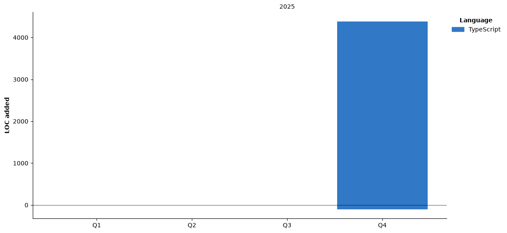

<!--START_SECTION:waka-->


**🐱 My GitHub Data** 

> 📦 14 Bytes Used in GitHub's Storage 
 > 
> 💼 Opted to Hire
 > 
> 📜 3 Public Repositories 
 > 
> 🔑 0 Private Repositories 
 > 
**I'm a Night 🦉** 

```text
🌞 Morning                0 commits           ░░░░░░░░░░░░░░░░░░░░░░░░░   00.00 % 
🌆 Daytime                1 commits           █░░░░░░░░░░░░░░░░░░░░░░░░   05.26 % 
🌃 Evening                12 commits          ████████████████░░░░░░░░░   63.16 % 
🌙 Night                  6 commits           ████████░░░░░░░░░░░░░░░░░   31.58 % 
```
📅 **I'm Most Productive on Tuesday** 

```text
Monday                   4 commits           █████░░░░░░░░░░░░░░░░░░░░   21.05 % 
Tuesday                  13 commits          █████████████████░░░░░░░░   68.42 % 
Wednesday                2 commits           ███░░░░░░░░░░░░░░░░░░░░░░   10.53 % 
Thursday                 0 commits           ░░░░░░░░░░░░░░░░░░░░░░░░░   00.00 % 
Friday                   0 commits           ░░░░░░░░░░░░░░░░░░░░░░░░░   00.00 % 
Saturday                 0 commits           ░░░░░░░░░░░░░░░░░░░░░░░░░   00.00 % 
Sunday                   0 commits           ░░░░░░░░░░░░░░░░░░░░░░░░░   00.00 % 
```


📊 **This Week I Spent My Time On** 

```text
🕑︎ Time Zone: Asia/Dhaka

💬 Programming Languages: 
TypeScript               4 hrs 55 mins       ████████░░░░░░░░░░░░░░░░░   31.28 % 
Rust                     4 hrs               ██████░░░░░░░░░░░░░░░░░░░   25.48 % 
Bash                     1 hr 23 mins        ██░░░░░░░░░░░░░░░░░░░░░░░   08.81 % 
YAML                     1 hr 11 mins        ██░░░░░░░░░░░░░░░░░░░░░░░   07.56 % 
Other                    1 hr 3 mins         ██░░░░░░░░░░░░░░░░░░░░░░░   06.67 % 

🔥 Editors: 
Neovim                   15 hrs 45 mins      █████████████████████████   100.00 % 

🐱‍💻 Projects: 
crabwalk                 4 hrs 17 mins       ███████░░░░░░░░░░░░░░░░░░   27.24 % 
irfanshadikrishad.uk     2 hrs 26 mins       ████░░░░░░░░░░░░░░░░░░░░░   15.46 % 
kavro                    2 hrs 10 mins       ███░░░░░░░░░░░░░░░░░░░░░░   13.83 % 
dotfiles                 2 hrs 3 mins        ███░░░░░░░░░░░░░░░░░░░░░░   13.01 % 
Unknown Project          1 hr 27 mins        ██░░░░░░░░░░░░░░░░░░░░░░░   09.23 % 

💻 Operating System: 
Linux                    15 hrs 45 mins      █████████████████████████   100.00 % 
```

🤖 **AI Coding This Week** 

```text
No AI Coding Activity Tracked This Week
```

**I Mostly Code in TypeScript** 

```text
TypeScript               1 repo              █████████████████████████   100.00 % 
```


**Timeline**




 Last Updated on 13/11/2026 23:45:07 UTC
<!--END_SECTION:waka-->
