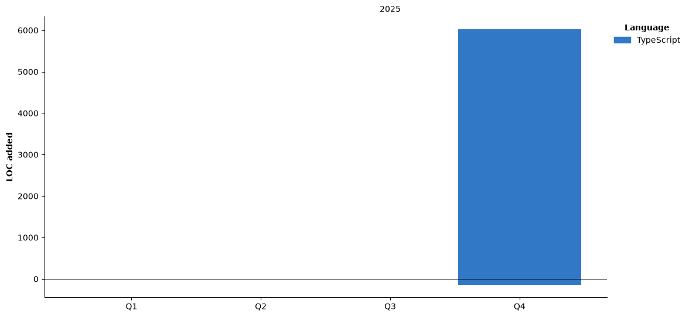

<!--START_SECTION:waka-->


**🐱 My GitHub Data** 

> 📦 16 Bytes Used in GitHub's Storage 
 > 
> 💼 Opted to Hire
 > 
> 📜 3 Public Repositories 
 > 
> 🔑 0 Private Repositories 
 > 
**I'm a Night 🦉** 

```text
🌞 Morning                0 commits           ░░░░░░░░░░░░░░░░░░░░░░░░░   00.00 % 
🌆 Daytime                1 commits           █░░░░░░░░░░░░░░░░░░░░░░░░   04.55 % 
🌃 Evening                15 commits          █████████████████░░░░░░░░   68.18 % 
🌙 Night                  6 commits           ███████░░░░░░░░░░░░░░░░░░   27.27 % 
```
📅 **I'm Most Productive on Tuesday** 

```text
Monday                   4 commits           █████░░░░░░░░░░░░░░░░░░░░   18.18 % 
Tuesday                  16 commits          ██████████████████░░░░░░░   72.73 % 
Wednesday                2 commits           ██░░░░░░░░░░░░░░░░░░░░░░░   09.09 % 
Thursday                 0 commits           ░░░░░░░░░░░░░░░░░░░░░░░░░   00.00 % 
Friday                   0 commits           ░░░░░░░░░░░░░░░░░░░░░░░░░   00.00 % 
Saturday                 0 commits           ░░░░░░░░░░░░░░░░░░░░░░░░░   00.00 % 
Sunday                   0 commits           ░░░░░░░░░░░░░░░░░░░░░░░░░   00.00 % 
```


📊 **This Week I Spent My Time On** 

```text
🕑︎ Time Zone: Asia/Dhaka

💬 Programming Languages: 
Rust                     6 hrs 22 mins       █████████░░░░░░░░░░░░░░░░   37.33 % 
TypeScript               4 hrs 50 mins       ███████░░░░░░░░░░░░░░░░░░   28.38 % 
Bash                     1 hr 23 mins        ██░░░░░░░░░░░░░░░░░░░░░░░   08.13 % 
YAML                     59 mins             █░░░░░░░░░░░░░░░░░░░░░░░░   05.79 % 
Other                    54 mins             █░░░░░░░░░░░░░░░░░░░░░░░░   05.29 % 

🔥 Editors: 
Neovim                   17 hrs 5 mins       █████████████████████████   100.00 % 

🐱‍💻 Projects: 
crabwalk                 6 hrs 59 mins       ██████████░░░░░░░░░░░░░░░   40.91 % 
irfanshadikrishad.uk     2 hrs 42 mins       ████░░░░░░░░░░░░░░░░░░░░░   15.83 % 
kavro                    2 hrs 10 mins       ███░░░░░░░░░░░░░░░░░░░░░░   12.75 % 
Unknown Project          1 hr 23 mins        ██░░░░░░░░░░░░░░░░░░░░░░░   08.14 % 
dotfiles                 1 hr 11 mins        ██░░░░░░░░░░░░░░░░░░░░░░░   06.99 % 

💻 Operating System: 
Linux                    17 hrs 5 mins       █████████████████████████   100.00 % 
```

🤖 **AI Coding This Week** 

```text
No AI Coding Activity Tracked This Week
```

**I Mostly Code in TypeScript** 

```text
TypeScript               1 repo              █████████████████████████   100.00 % 
```


**Timeline**




 Last Updated on 17/11/2026 01:55:20 UTC
<!--END_SECTION:waka-->
